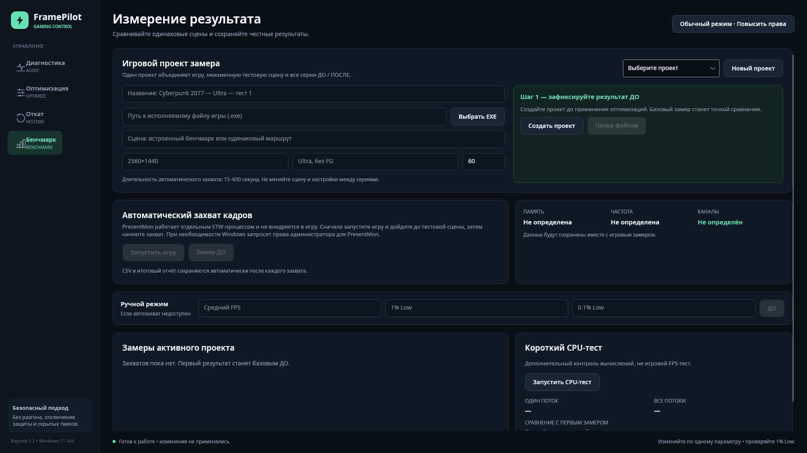

<p align="center">
  
</p>

<h1 align="center">FramePilot</h1>

<p align="center">
  Safe, reversible Windows 11 gaming optimization with repeatable before/after benchmarks.
</p>

<p align="center">
  <strong>Version 1.2.0 · Windows 11 x64 · .NET 8 · Avalonia · PresentMon 2.6</strong>
</p>



## Overview

FramePilot helps you audit a gaming PC, apply a conservative set of reversible Windows optimizations, and measure whether those changes actually improve a particular game and scene.

The application does not promise an FPS increase. Its main workflow is designed to prove or reject the result with repeated measurements:

**Game project → BEFORE captures → optimization → AFTER captures → comparison**

The interface is currently in Russian.

## Highlights

- Full-screen Avalonia interface for Windows 11 x64.
- System audit for CPU, GPU and driver, Windows, memory amount, memory speed, HAGS, and power configuration.
- Approximate memory channel-mode reporting with an explicit uncertainty notice.
- Reversible optimization with a saved backup and a dedicated Restore section.
- Optional temporary stop of a small allowlisted set of services: Windows Search, Print Spooler, and Fax. Their startup types are not changed.
- Shader-cache preparation without deleting the cache.
- HAGS A/B guidance.
- Project-based game benchmarks with the same executable, scene, resolution, and graphics preset.
- Automatic frame capture through Intel PresentMon ETW, without DLL injection into the game.
- Manual benchmark entry as a fallback.
- Average FPS, 1% Low, 0.1% Low, average frame time, and raw frame-time CSV.
- Median summary across repeated BEFORE and AFTER runs.
- Green, neutral, and red comparison states using a ±3% confirmation threshold.
- Environment mismatch warnings for hardware, GPU driver, game version, memory configuration, scene, resolution, and graphics preset changes.
- Recovery of an interrupted capture from its pending CSV.
- Portable self-contained build: no separate .NET or PresentMon installation is required.

## Benchmark methodology

FramePilot calculates average FPS from the arithmetic mean of valid frame times. The 1% Low and 0.1% Low values are calculated from the average frame time of the slowest 1% and 0.1% of frames. Generated and interpolated frames are excluded.

Multiple captures are summarized by the median of each metric. A change is marked as an improvement at +3% or higher, as a degradation at −3% or lower, and as neutral inside that range. For frame time, the percentage is inverted because lower is better.

For a more reliable comparison, run at least three BEFORE and three AFTER captures without changing the scene or settings. FramePilot warns when this condition is not met.

## Download and quick start

1. Open the repository **Releases** page.
2. Download `FramePilot-Windows11-x64.zip`.
3. Extract it and run `FramePilot.exe`.
4. Open **Diagnostics** and inspect the system report.
5. Open **Benchmark**, create a game project, and select the actual game executable.
6. Describe a repeatable scene or built-in benchmark, then save at least one BEFORE capture. Three captures are recommended.
7. Apply the desired optimizations.
8. Return to the same project and repeat the same scene for AFTER captures.
9. Review the median comparison, environment warnings, raw CSV files, and text summaries.
10. Use **Restore** if you want to roll back the applied Windows changes.

Windows may request administrator approval when elevated access is required, including for PresentMon ETW capture.

## Data storage

FramePilot stores its state under:

```text
%LocalAppData%\FramePilot
```

Important files and folders include:

```text
backup-last.json
benchmark-projects.json
BenchmarkRuns\<project-id>\*.csv
BenchmarkRuns\<project-id>\*.summary.txt
tools\PresentMon-2.6.0-x64.exe
```

## Build from source

### Requirements

- .NET 8 SDK
- Windows 11 x64 to use the application and its Windows-specific optimization features

### Build

```bash
dotnet restore src/FramePilot.csproj
dotnet build src/FramePilot.csproj -c Release
```

### Publish a portable single-file executable

```bash
dotnet publish src/FramePilot.csproj \
  -c Release \
  -r win-x64 \
  --self-contained true \
  -o publish \
  -p:PublishSingleFile=true \
  -p:IncludeNativeLibrariesForSelfExtract=true
```

The resulting `publish/FramePilot.exe` is a self-contained Windows x64 application.

## Safety boundaries

FramePilot does not:

- change BIOS settings or apply overclocking;
- disable Microsoft Defender, VBS/HVCI, the firewall, Windows Update, or CPU vulnerability mitigations;
- use Realtime process priority;
- inject code into games;
- mass-stop Windows services or change their startup types;
- delete shader caches as an optimization;
- guarantee an FPS improvement.

## Verification status

Version 1.2 has been checked for compilation, CSV parsing and metric calculations, complete manual BEFORE/AFTER workflows, median comparisons, color thresholds, persistence, interrupted-capture recovery, embedded PresentMon extraction and SHA-256 verification, and UI layouts at 1366×768, 1920×1080, and 2560×1440.

Real ETW capture must still be validated on the target Windows 11 PC with each specific game. PresentMon support and anti-cheat policies can vary by game.

## Third-party components

FramePilot bundles the official standalone **Intel PresentMon 2.6.0 x64** executable:

- Project: <https://github.com/GameTechDev/PresentMon>
- Release: <https://github.com/GameTechDev/PresentMon/releases/tag/v2.6.0>
- License: MIT, included in `src/Assets/PresentMon-LICENSE.txt`
- SHA-256: `b2a706bc6ad475749e3b7e3409263aa1e6906d45bdcf993f6dbc0f660188f1af`

The application also uses Avalonia, .NET, and System.Management through their respective package dependencies.
