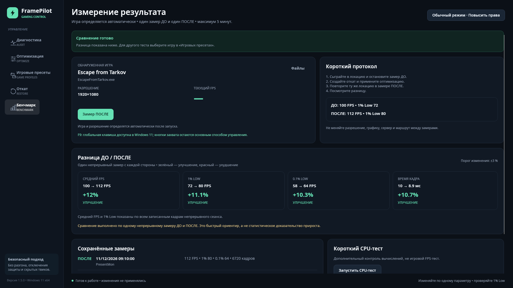

<p align="center">
  
</p>

<h1 align="center">FramePilot</h1>

<p align="center">
  Safe, reversible Windows 11 gaming optimization with a simple before/after FPS benchmark.
</p>

<p align="center">
  <strong>Version 1.5.0 · Windows 11 x64 · .NET 8 · Avalonia · PresentMon 2.6</strong>
</p>



## Overview

FramePilot audits a gaming PC, applies a conservative set of reversible Windows optimizations, and measures whether those changes improve a particular game and location. It does not promise an FPS increase.

The guided workflow is:

**Launch a supported game → one continuous BEFORE capture → backup and optimization → repeat the same location for one AFTER capture → comparison**

The interface is currently in Russian.

## Highlights

- Full-screen Avalonia interface for Windows 11 x64.
- Automatic detection of Escape from Tarkov, Counter-Strike 2, Rust, and PUBG by their actual game processes.
- Automatic game-window resolution detection, refined by the swap-chain `Width` and `Height` values in PresentMon CSV when available.
- Live FPS during capture, calculated from the latest 240 valid frames.
- One continuous BEFORE session and one AFTER session; no mandatory three-run series and no separate warmup stage.
- Manual stop with **F9** or **Stop and save**; each session is automatically limited to five minutes.
- Guided backup, Windows restore-point attempt, and conservative optimization between BEFORE and AFTER.
- Average FPS, 1% Low, 0.1% Low, average frame time, frame count, raw CSV, and text summaries.
- Green, neutral, and red comparison states using a ±3% display threshold.
- Clear warning that a single A/B pair is a quick indicator, not statistical proof of an improvement.
- Environment mismatch warnings for hardware, GPU driver, memory configuration, captured process, scene, resolution, and graphics preset changes.
- System audit for CPU, GPU and driver, Windows, memory amount and speed, HAGS, and power configuration.
- Approximate memory channel-mode reporting with an explicit uncertainty notice.
- Reversible optimization with a saved backup and a dedicated Restore section.
- Optional temporary stop of a small allowlisted set of services: Windows Search, Print Spooler, and Fax. Their startup types are not changed.
- Shader-cache preparation without deleting the cache.
- HAGS A/B guidance in the full Optimization section; HAGS and service stops are not changed by the quick guided workflow.
- Recovery of an interrupted capture from its pending CSV.
- Portable self-contained build: no separate .NET or PresentMon installation is required.

## Benchmark methodology

FramePilot calculates average FPS from the arithmetic mean of valid frame times. The 1% Low and 0.1% Low values are calculated from the average frame time of the slowest 1% and 0.1% of frames. Generated and interpolated frames are excluded. If `MsBetweenPresents` is unavailable, the parser falls back to `MsBetweenDisplayChange`, then `MsBetweenAppStart`.

A change is displayed as an improvement at +3% or higher, as a degradation at −3% or lower, and as neutral inside that range. For frame time, the percentage is inverted because lower is better.

Version 1.5 uses one uninterrupted capture on each side of the optimization. Repeat the same location, route, graphics settings, resolution, and game conditions as closely as possible. The result remains a quick A/B indicator: background activity, shader compilation, servers, and normal scene variation can still affect it.

The detected window client size is not necessarily the game's internal render resolution. Render scale and dynamic resolution are not inferred by FramePilot.

## Download and quick start

1. Open the repository **Releases** page.
2. Download `FramePilot-Windows11-x64.zip`.
3. Extract it and run `FramePilot.exe`.
4. Open **Game presets**, select a supported game, and click **Apply and test**.
5. Launch the game and enter the location you want to measure. FramePilot detects the game automatically.
6. Click **BEFORE capture** or press F9. Play the chosen location and watch the live FPS.
7. Click **Stop and save** or press F9 when finished. The session stops automatically after five minutes.
8. Click **Create restore point and optimize**. A local backup is saved; a Windows restore point is attempted when administrator rights allow it.
9. Return to the same game location and click **AFTER capture**.
10. Review the BEFORE/AFTER difference, environment warnings, raw CSV files, and text summaries.
11. Use **Restore** if you want to roll back the applied Windows changes.

Windows may request administrator approval for PresentMon ETW capture and restore-point creation.

## Data storage

FramePilot stores its state under:

```text
%LocalAppData%\FramePilot
```

Important files and folders include:

```text
backup-last.json
benchmark-projects.json
BenchmarkRuns\<project-id>\*.csv
BenchmarkRuns\<project-id>\*.summary.txt
tools\PresentMon-2.6.0-x64.exe
```

## Build from source

### Requirements

- .NET 8 SDK
- Windows 11 x64 to use the application and its Windows-specific optimization features

### Build

```bash
dotnet restore src/FramePilot.csproj
dotnet build src/FramePilot.csproj -c Release
```

### Publish a portable single-file executable

```bash
dotnet publish src/FramePilot.csproj \
  -c Release \
  -r win-x64 \
  --self-contained true \
  -o publish \
  -p:PublishSingleFile=true \
  -p:IncludeNativeLibrariesForSelfExtract=true
```

The resulting `publish/FramePilot.exe` is a self-contained Windows x64 application.

## Safety boundaries

FramePilot does not:

- change BIOS settings or apply overclocking;
- disable Microsoft Defender, VBS/HVCI, the firewall, Windows Update, or CPU vulnerability mitigations;
- use Realtime process priority;
- inject code into games;
- mass-stop Windows services or change their startup types;
- delete shader caches as an optimization;
- automatically edit game INI files, anti-cheat components, or global NVIDIA profiles;
- guarantee an FPS improvement.

## Verification status

Version 1.5.0 has been checked for Release compilation, legacy JSON compatibility, continuous-capture defaults, single A/B comparison, live FPS parsing from a large growing CSV, resolution extraction, generated/interpolated-frame filtering, F9 stage selection, process-mismatch warnings, automatic project creation, atomic project persistence, and summary generation. All 53 regression checks pass. UI layouts were inspected at 1366×768 and 1920×1080.

Real Windows ETW capture, global F9 registration, automatic process detection, restore-point creation, and the reported freeze fix must still be validated on the target Windows 11 PC with each specific game. PresentMon support and anti-cheat policies can vary by game. Live FPS updates depend on PresentMon flushing its CSV during capture.

## Third-party components

FramePilot bundles the official standalone **Intel PresentMon 2.6.0 x64** executable:

- Project: <https://github.com/GameTechDev/PresentMon>
- Release: <https://github.com/GameTechDev/PresentMon/releases/tag/v2.6.0>
- License: MIT, included in `src/Assets/PresentMon-LICENSE.txt`
- SHA-256: `b2a706bc6ad475749e3b7e3409263aa1e6906d45bdcf993f6dbc0f660188f1af`

The application also uses Avalonia, .NET, and System.Management through their respective package dependencies.
